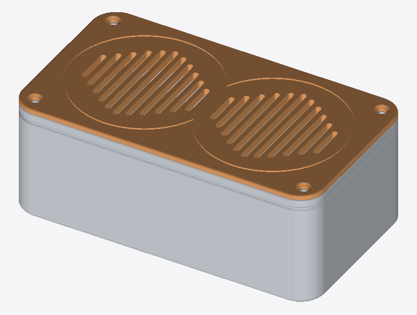

# 🤖 J.A.R.V.I.S. — Assistente de voz com IA, feito do zero

Assistente de voz caseiro com **ESP32-S3**: você diz **“Jarvis”** e fala, sem apertar nada.
O ESP32 cuida da escuta e dos alarmes, e a inteligência roda num servidor **gratuito** no Netlify.
**R$ 0 por mês de servidor.**

<p align="center"> &nbsp; </p>

> 🎬 Este é o projeto da série **“Criando uma IA do zero”** no Instagram e no TikTok.

## O que ele faz
- 🗣️ **Acorda com “Jarvis”**: o reconhecimento roda no próprio chip, sem internet. Com o cancelamento de eco, dá para interromper o Jarvis no meio da fala.
- 🧠 **Conversa com IA** (Gemini), respondendo com voz neural em português.
- 🎵 **Spotify**: “toca Coldplay”, “pausa”, “próxima”.
- 💡 **Casa inteligente** (SmartLife/Tuya): “liga a luz da sala”.
- ⏰ **Alarmes, lembretes e timers**, que tocam mesmo sem Wi-Fi.
- 📖 **Bíblia (YouVersion)**: lê o devocional e as passagens do dia do seu plano.
- 🌦️ Clima, notícias, cotações, Wikipédia, listas, rotinas e datas especiais.
- 📱 **Painel de controle** pelo celular.

## Passo a passo
| | Guia | O que tem |
|---|---|---|
| 1 | [Lista de materiais](docs/01-materiais.md) | Tudo o que comprar |
| 2 | [Montagem e ligações](docs/02-montagem.md) | Diagrama dos fios e montagem na caixa |
| 3 | [Caixa em 3D](hardware/caixa-3d/) | Arquivos STL e configuração de impressão |
| 4 | [Servidor grátis (Netlify)](docs/03-netlify.md) | Deploy com 1 clique, chaves de API e senhas |
| 5 | [Firmware (Arduino IDE)](docs/04-firmware.md) | Bibliotecas, configurações e gravação no ESP32-S3 |
| 6 | [Como usar](docs/05-como-usar.md) | Comandos de voz, botão, LED e painel |
| 7 | [Problemas comuns](docs/06-problemas.md) | O que fazer se algo não funcionar |

[](https://app.netlify.com/start/deploy?repository=https://github.com/Carlos05125877/Assistente-de-Voz)

## Como funciona
```
 "Jarvis, ..."
     │
 ESP32-S3 ── palavra "Jarvis", eco, ruído e fim da fala (offline)
     │        alarmes · lembretes · timers · rotinas (offline)
     ├──► Groq Whisper ........ voz → texto (grátis)
     └──► Netlify (grátis) .... Gemini + ferramentas → resposta em voz (MP3)
                                 Spotify · casa · Bíblia · clima · painel
```

## Estrutura do repositório
```
firmware/jarvis_s3/           sketch da Arduino IDE (abra o jarvis_s3.ino)
firmware/srmodels_jarvis.bin  modelo de voz da palavra "Jarvis"
hardware/caixa-3d/            STL e imagens da caixa
netlify/ e public/            servidor e painel (deploy no Netlify)
docs/                         tutoriais
tests/                        testes do servidor (npm test)
```

## Licença
[MIT](LICENSE): pode usar, modificar e compartilhar, desde que mantenha o aviso de autoria.
As bibliotecas de terceiros têm licenças próprias. Por exemplo, a arduino-libhelix é GPLv3 e o ESP-SR segue a licença da Espressif.

> ⚠️ As integrações com o YouVersion e com a voz do Edge (Microsoft) usam APIs **não oficiais** e podem mudar sem aviso. Use só com a sua própria conta.
