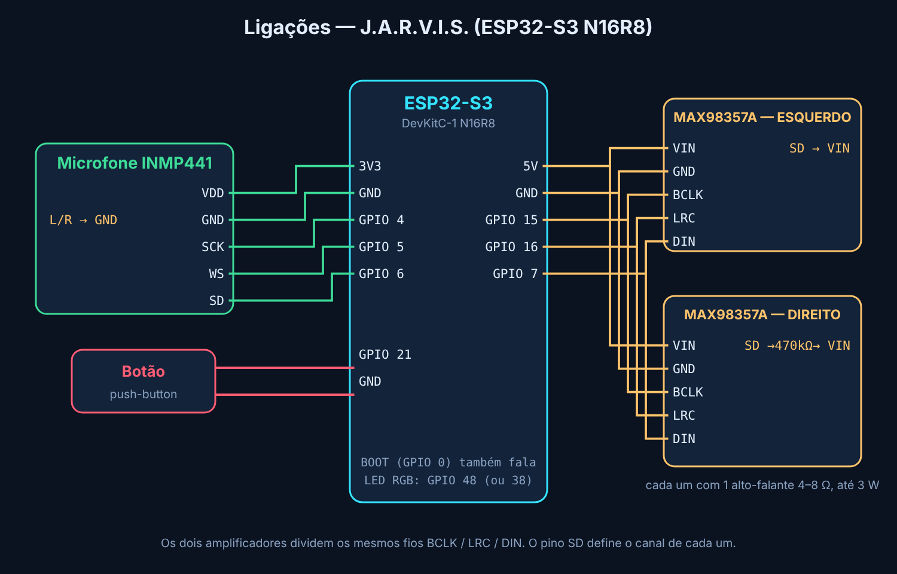

# 2. Montagem e ligações

## Tabela de ligações

**Microfone INMP441**
| INMP441 | ESP32-S3 |
|---|---|
| VDD | 3V3 |
| GND | GND |
| L/R | GND (canal esquerdo) |
| SCK | GPIO 4 |
| WS | GPIO 5 |
| SD | GPIO 6 |

**Amplificadores MAX98357A** (os dois nos mesmos pinos)
| MAX98357A | ESP32-S3 |
|---|---|
| VIN | 5V |
| GND | GND |
| BCLK | GPIO 15 |
| LRC | GPIO 16 |
| DIN | GPIO 7 |

**Canal de cada amplificador (pino SD):**
- **Esquerdo:** ligue o SD direto no VIN (acima de 1,4 V = canal esquerdo).
- **Direito:** ligue um resistor de **470 kΩ** entre o SD e o VIN. Com o multímetro, o SD deve ficar entre 0,77 V e 1,4 V. Se não ficar, teste resistores entre 330 kΩ e 470 kΩ.
- Sem nada no SD, o amplificador toca a mistura dos dois canais. Funciona, mas sem estéreo.

**Botão:** um lado no GPIO 21 e o outro no GND. O botão BOOT da placa (GPIO 0) faz a mesma coisa.

**LED:** é o LED RGB da própria placa, no GPIO 48. Na DevKitC-1 v1.1 ele fica no GPIO 38: troque `PIN_RGB_LED` em `config.h`.

> ⚠️ Não use os GPIO 19/20 (USB), 26–37 (memória flash e PSRAM) nem 43/44 (serial).
> Os pinos podem ser trocados em `firmware/jarvis_s3/config.h`.

## Montagem na caixa
1. Imprima a base e a tampa (veja a [pasta da caixa 3D](../hardware/caixa-3d/)).
2. Encaixe os dois alto-falantes no suporte por baixo da tampa, um em cada grade.
3. Fixe o ESP32-S3 e os amplificadores nos pinos da base.
4. Deixe o microfone virado para fora, perto de uma abertura, e **longe dos alto-falantes**. Isso ajuda o cancelamento de eco.
5. Passe o cabo USB-C pela abertura lateral.
6. Antes de fechar, grave o firmware e teste tudo ([guia 4](04-firmware.md)).
7. Feche a tampa com 4 parafusos M3.

Próximo: [3. Servidor grátis (Netlify) →](03-netlify.md)
