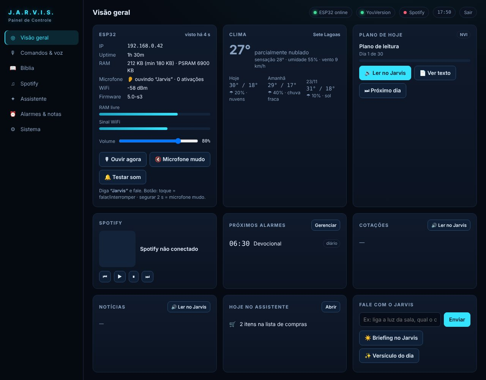

# 5. Como usar

Diga **“Jarvis”**, espere o bipe curto (cerca de meio segundo) e faça o pedido.
Se a resposta terminar com uma pergunta, responda direto, sem repetir “Jarvis”.
Para interromper enquanto ele fala, diga “Jarvis” de novo ou toque no botão.

## Exemplos de comandos
| Área | Diga |
|---|---|
| Conversa | “Jarvis, explica como funciona um buraco negro” |
| Bíblia | “leia meu plano de hoje”, “avance para o próximo dia”, “liste meus planos”, “leia Salmos 23” |
| Briefing | “me dá o briefing” (clima, alarmes, lembretes, aniversários e devocional) |
| Spotify | “toca Coldplay”, “pausa”, “próxima”, “volume do Spotify em 40” |
| Casa | “liga a luz da sala”, “fita LED em azul” |
| Alarmes e timers | “alarme às 6 e meia”, “timer de 10 minutos” |
| Lembretes | “me lembra amanhã às 9 de pagar a conta”, “daqui a 20 minutos tirar o bolo” |
| Listas | “adiciona leite e café na lista de compras”, “o que tem na lista de tarefas?” |
| Rotinas | “ativa a rotina boa noite”, “modo foco” |
| Informação | “notícias de hoje”, “quanto está o dólar?”, “quem foi Santos Dumont?”, “quantos dias faltam pro Natal?” |
| Privacidade | “desliga o microfone” |

> 💡 Se o nome do alarme tiver **“devocional”** ou **“briefing”**, quando você desligar o alarme o Jarvis já lê o briefing do dia.

## Botão
| Ação | Resultado |
|---|---|
| Toque | Fala (ou interrompe e já escuta) |
| Segurar 2 s | Microfone mudo / ativo (privacidade) |

## Cores do LED
| Cor | Estado |
|---|---|
| Azul fraco | Esperando “Jarvis” |
| Ciano | Ouvindo |
| Roxo | Pensando |
| Verde | Falando |
| Âmbar | Microfone mudo |
| Amarelo | Sem Wi-Fi |
| Vermelho | Erro |

## Sem internet
A palavra “Jarvis” continua funcionando, mas o pedido não; nesse caso ele avisa com um som.
**Alarmes, lembretes e timers tocam normalmente.**
Para parar um alarme, use o botão ou diga “Jarvis”.

## Painel de controle
Abra o endereço do seu site no Netlify e entre com a `PANEL_PASSWORD`.

| Aba | Para quê |
|---|---|
| Visão geral | Estado do ESP32, clima, plano do dia, alarmes, cotações e notícias |
| Comandos & voz | Fazer o Jarvis falar, testar vozes e ver o histórico |
| Bíblia | Login no YouVersion, planos e leitor |
| Spotify | Tocar e controlar a música |
| Assistente | Lembretes, listas, rotinas e datas especiais |
| Alarmes & notas | Alarmes e timers |
| Sistema | Configurações, palavra “Jarvis”, chaves de API e casa inteligente |

Próximo: [6. Problemas comuns →](06-problemas.md)
