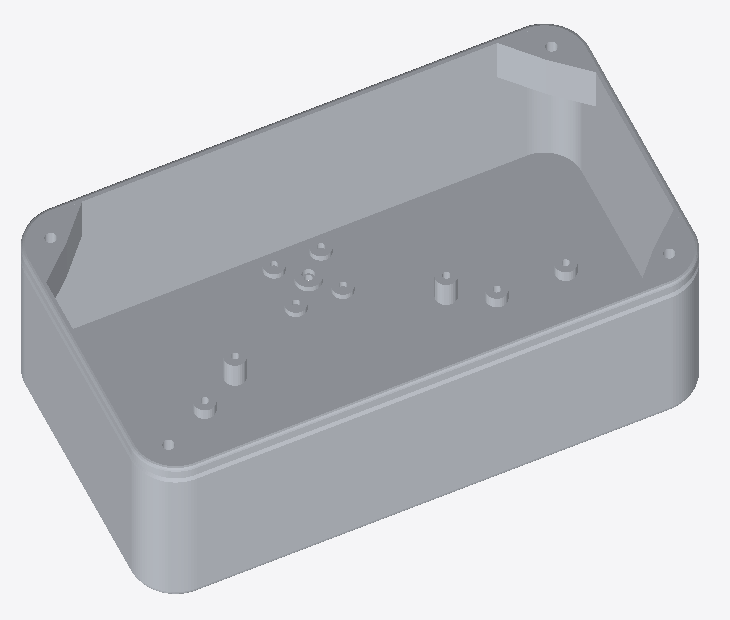
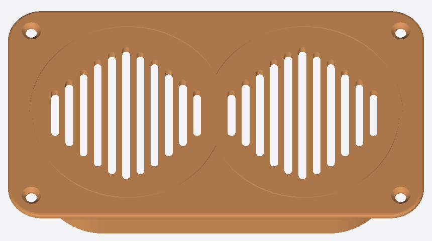
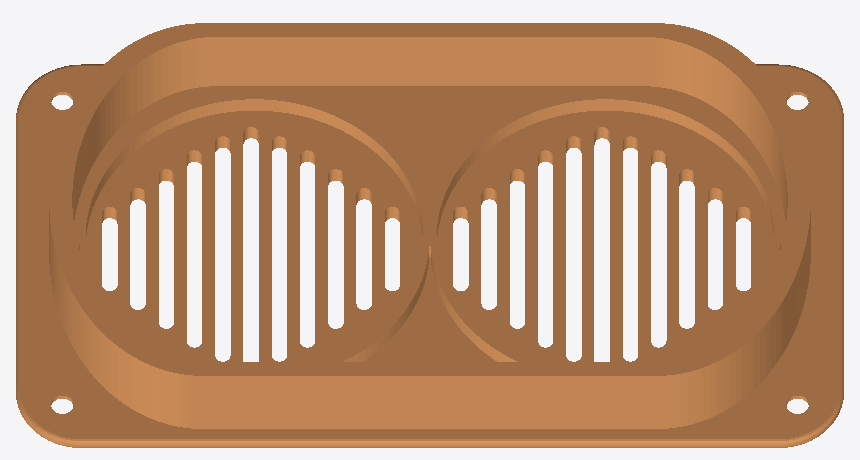

# Caixa em 3D

| Caixa montada | Base | Tampa | Tampa por baixo |
|---|---|---|---|
|  |  |  |  |

## Arquivos para imprimir
| Arquivo | Peça | Tamanho (L × P × A) |
|---|---|---|
| [`jarvis_base.stl`](jarvis_base.stl) | Base, com os pinos de fixação das placas | 125 × 70 × 45 mm |
| [`jarvis_tampa.stl`](jarvis_tampa.stl) | Tampa, com as duas grades e o encaixe dos alto-falantes | 125 × 70 × 16 mm |
| [`jarvis_caixa_e_tampa_v6.stl`](jarvis_caixa_e_tampa_v6.stl) | As duas peças juntas, já posicionadas para imprimir numa mesa só | — |

As peças já estão na posição de impressão. A tampa fica com a face das grades virada para a mesa.

## Configuração de impressão sugerida
| Parâmetro | Valor |
|---|---|
| Material | PLA (ou PETG se ficar no sol/calor) |
| Altura de camada | 0,2 mm |
| Paredes | 3 |
| Preenchimento | 15–20 % |
| Suporte | Base: não. Tampa: imprima **com a face das grades na mesa**, sem suporte |
| Parafusos | 4× M3 |

## Antes de imprimir
- Confira o **diâmetro dos seus alto-falantes** com o encaixe por baixo da tampa.
- Confira a posição da abertura do **USB-C** na base.
